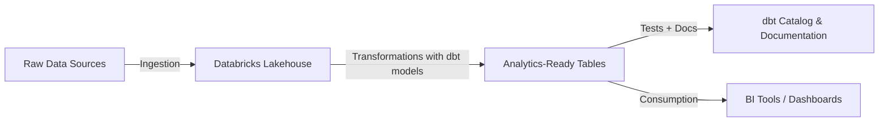

# dbtAnalytics

This project was developed as part of the **dbt Fundamentals Certification Course**.  
It demonstrates the use of **dbt (Data Build Tool)** on **Databricks** to build reliable and modular data pipelines.

---

## 📌 Project Overview
The project showcases:
- Setting up dbt with **Databricks** as the underlying data platform  
- Building modular **models** to transform raw data into analytics-ready datasets  
- Defining and managing **sources** to ensure traceability  
- Implementing **data tests** (unique, not null, accepted values, relationships) for data quality  
- Adding **documentation** and doc blocks for better maintainability  
- Deploying transformations with **dbt jobs** and understanding the **dbt Catalog**  

---

## 📂 Repository Structure
- `models/` – Core transformation logic  
- `seeds/` – Seed datasets for testing and demos  
- `analyses/` – Ad-hoc analysis queries  
- `snapshots/` – Track historical changes in data  
- `tests/` – Data quality checks  
- `macros/` – Reusable SQL snippets and helper functions  
- `dbt_project.yml` – Main dbt project configuration  

---

## ⚙️ Key Learnings
1. Gained hands-on experience in **Analytics Development Lifecycle (ADLC)** using dbt.  
2. Designed modular and reusable SQL transformations with the **ref** macro.  
3. Implemented robust **data testing and documentation practices** to build trustworthy analytics datasets.  
4. Deployed dbt jobs on **Databricks** and explored the **dbt Catalog** for lineage and documentation.  

---

## 🚀 Getting Started
1. Clone the repository  
   ```bash
   git clone https://github.com/Krutik4/dbtAnalytics.git
   ```
2. Install dbt and configure it for Databricks.  
3. Run the following commands:  
   ```bash
   dbt run
   dbt test
   dbt docs generate
   dbt docs serve
   ```

---

## 🏗️ Architecture Diagram
Below is a simple representation of how dbt integrates with Databricks:



---

## 📖 Resources
- [dbt Documentation](https://docs.getdbt.com)  
- [dbt Community](https://getdbt.com/community)  
- [Databricks + dbt Setup Guide](https://docs.getdbt.com/docs/dbt-cloud/cloud-quickstart-databricks)  

---

## 🏆 Certification
This project was built as part of the **dbt Fundamentals Certification**, where I applied concepts across modeling, sources, testing, documentation, and deployment on Databricks.
